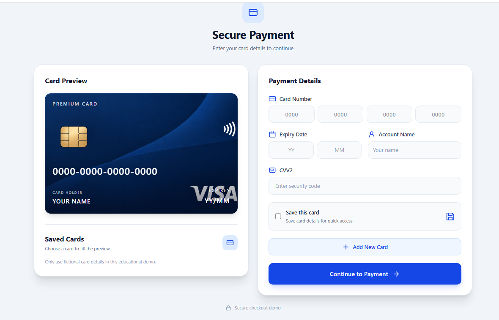

# 💳 Card Project – Educational Payment Gateway

A responsive and interactive educational payment gateway interface built with HTML, CSS, JavaScript, and Tailwind CSS.

This project simulates a simple bank card payment experience, created to practice Front-End development.

## 🌐 Live Demo

🚀 [View Live Demo](https://mhmdkbyry908-art.github.io/card-project/)

## 📸 Project Preview



## ✨ Features

- Interactive bank card interface
- 16-digit bank card number input
- Cardholder name input
- CVV2 and expiration date fields
- Save bank cards using LocalStorage
- Display previously saved cards
- Select saved cards to automatically fill information
- CVV2 is requested again and is never stored
- Responsive design for desktop and mobile devices

## 🛠️ Technologies Used

- HTML5
- CSS3
- JavaScript
- Tailwind CSS v4
- Vite
- LocalStorage API

## 🚀 Getting Started

Clone the repository:

```bash
git clone https://github.com/mhmdkbyry908-art/card-project.git
```

Navigate to the project directory:

```bash
cd card-project
```

Install dependencies:

```bash
npm install
```

Start the development server:

```bash
npm run dev
```

Build for production:

```bash
npm run build
```

## ⚠️ Disclaimer

This is an educational Front-End project only.

It does not process real payments or connect to any banking system. Do not enter real banking information.

## 👨‍💻 Author

**Mohammad Kabiri**

- GitHub: [@mhmdkbyry908-art](https://github.com/mhmdkbyry908-art)
- Live Demo: [Card Project](https://mhmdkbyry908-art.github.io/card-project/)

---

⭐ If you like this project, feel free to star the repository!
